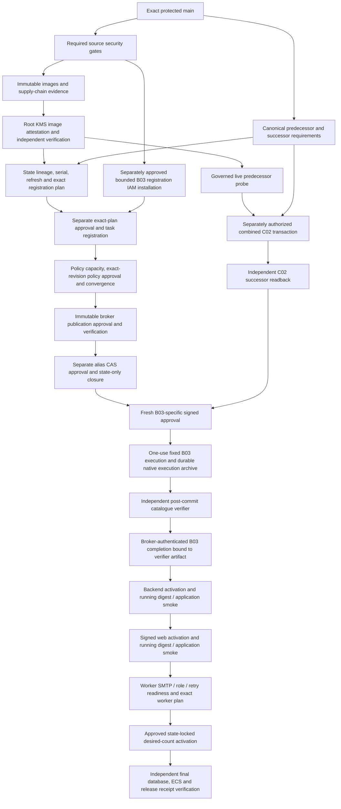

# Production release pre-execution certification

Scope: CHG-20261028-001; account 368992683803, eu-west-2. Baseline
9b901d072f64b680db4e979ecf3641f701023e91. This document and the source graph
are not deployment authorization. Do not rerun the completed state148 write or
serial149 recovery. No production mutation was performed while preparing this change.

## Executable DAG

From a clean reviewed checkout:

```sh
node scripts/aws/certify-production-backend-release-gate.mjs --source-only --graph-only --source-sha "$(git rev-parse HEAD)"
# Provide an explicit, isolated loopback PostgreSQL 18 database, with TLS and
# the existing certification administrator (mscqr_p2_test), before this command.
# The existing integration guard rejects production/non-loopback targets.
npm run release:certify:source
```

The aggregate runs the existing Stage B closure checks, adjacent release-contract
suites, and the actual PostgreSQL integration test with skipping disabled. It
fails if its disposable-database URL is absent. CI also runs the graph, worker
transition, registration, broker and completion regression tests. The existing
CI PostgreSQL image remains digest-pinned at 18.4; local certification used 18.6.
Neither source graph checks nor local PostgreSQL tests certify successful AWS writes.



C02 can be prepared alongside infrastructure. Its committed verification must
precede B03 authorization/execution; backend activation requires both. Worker
activation is last. The security-rebaseline signer/broker continuation project
is not a prerequisite of this selected, existing release lane.

## Adjacent contracts and failure boundaries

| Stage / source | Expected input and actual baseline | Authorization and side effects | Output / postcondition and remaining live check |
|---|---|---|---|
| Source / `stage-b-deployment-identity.mjs` | Fresh origin/main, clean exact checkout; baseline9b901d0 | Read-only; recheck before every privileged transition | Source advance blocks old source-bound evidence; merging fixes requires fresh current-source artifacts |
| Security / `check-required-workflow-gates.mjs` | Exact workflow IDs and attempts; baseline seven push workflows passed | Required gates cannot be skipped; incomplete executable provenance is not certified | Required current-head CI, security and supply-chain gates must pass after merge |
| Images / image workflows and publication identity | Four-image41264442925 and web41264446131 passed; canonical archive + ECR digests authenticated | Existing image OIDC roles; `production-web-image-publish` approval for web; immutable pushes only | Do not republish baseline images; canonical classifier and first-B03 exact-source requirement decide new-source reuse |
| Image authorization / `production-image-authorization.mjs` | Root-signed report; baseline authorization41307938481 | Root-only KMS Sign; independent pinned/KMS verification; `production` approval | 24-hour evidence; never reuse baseline authorization for the merged correction source |
| State / refresh and committed149 contracts | Lineage4e438e59-8b8b-194d-030c-5ede0c26344a, serial149, raw SHA460f16abd11468edbd6681f968eb87e030b27d37f844e58976fe0cc12a4ba9ce | Read-only refresh/plan; existing recovered receipt retained | Any serial/lineage change requires fresh preparation, not forced state; existing IAM permissions independently unchanged |
| Fixed B03 preparation / `produce-production-b03-executor-definition.mjs` | Authenticated d785aa7f predecessor and exact-current-source successor artifact references; immutable backend image; native RDS identity | Read-only; no SQL or secret values; references checked before expensive workflow gates | Canonical fixed definition embedded and sealed in tfvars; missing/mismatched references fail closed; installed B03 remains retained |
| Registration IAM / source managed policies | B03 registration was absent from the twelve-family manifest; the existing twelve-family grant excludes B03 | New exact-family registration/tag policy; existing exact execution-role PassRole reused; explicit deny of direct B03 RunTask/StartTask and administrator-secret reads. FinalApplyWrite and existing ownership permissions remain unchanged | Separate reviewed privileged installation approval required; use the existing reviewed root/admin installation boundary for only this new policy; read back all policies/attachments and run native permission simulations. This is a prerequisite, not an implicit coordinator permission |
| Registration / staged broker contracts | Exact pinned-provider plan: twelve reviewed rotations plus optional fixed B03 create/no-op | `production` phase approval; exact saved plan/KMS authorization, reservation and state lock; task registration only | Authenticated native ECS readback and one-use registration receipt include all13 definitions; legacy12 receipts remain supported; no service desired-count change |
| Policy / `deriveBrokerPolicy` | Nine fixed full-RLS revisions plus exactly the registered B03 revision, when present | Separate governed policy/pruning approval; exact IAM document, least-privilege PassRole unchanged | No wildcard B03 revision, no normal Release Gate privileged launch grant; policy receipt and historical handoff authenticate the new set |
| Broker / coordinator publication, cutover and closure | Reviewed alias v21; source-bound package, registration, policy and alias RevisionId | Separate publication and CAS approvals; immutable version, then CAS; state-only closure | Native code/config/hash/alias readbacks, signed durable receipts and converged state required; restart adopts completed phases, never republishes blindly |
| C02 / `apply-production-c02-session-prerequisite.mjs` | Exact authenticated predecessor, canonical combined package, correct DB identity | Existing separately root-authorized fixed C02 mechanism; not a normal Release Gate privilege; no direct SQL session | Transactional additive session column, reviewed printing functions/policies/grants; preserve data/owners/FORCE RLS; fresh independent catalogue verification required |
| B03 approval / canonical Stage B signer/publication | Current source/image, exact registered task revision, package, DB, C02 successor and final catalogue | Independent checker signing and existing publication approval; operation-specific expiry/nonce | Cross-mode, substituted, expired and replayed approvals rejected; installation approval is distinct from image approval |
| B03 execution / broker and `apply-production-b03-incremental-release.mjs` | Fixed task, no runtime overrides; valid signed B03 approval | Broker alone launches SQL task once; reservation and native task binding | Poll status only after launch. Broker durably archives native successful execution before ECS retention expires; pending/unknown is not completion and never permits SQL relaunch |
| B03 completion / `production-b03-completion.mjs` | Native archive plus fresh independently authenticated compatibility artifact | Broker-owned conditional DDB claim and encrypted durable receipt; no caller self-hash authority | Source/image/task/package/DB/catalgoue/execution identity match; verifier task differs and is after commit; 15-minute verification age, 30-minute completion expiry; expired completion needs fresh read-only verification, not SQL replay |
| Backend / existing Release Gate recovery lane | Same-source immutable image and authenticated C02+B03 receipt; historical live backend metadata conflicts must use authenticated provenance | `production` environment, existing deployment role, existing CAS/rollback | Running task digest2/2, database startup readbacks, login, tenant isolation, QR/printer smoke and authenticated component receipt |
| Frontend / `production-web-activation.yml` | Signed image/activation authorization and completed compatible same-source backend evidence | Existing web environment approval; existing OIDC/IAM boundary | Publication is not activation. Activate if authorized/live digests differ; running digest2/2 and `/audit/logs` entityIds compatibility/smoke |
| Worker / existing support-worker root | Current immutable worker image; B03 worker identity, exact SMTP secret reference, connectivity and retry semantics | Separately approved exact state-locked worker plan; desired count0→1 only | Generic candidate registration does not activate worker. Dedicated existing SMTP policy remains its sole grant owner. Historical eligible messages authorized; UNKNOWN delivery is not blindly retried. Verify1/1, logs, queue outcomes; stop on abnormal duplicates/repeated failures |
| Final verification | Native state, database, running tasks, application smoke and referenced receipts | Read-only; no telemetry/customer-data writes merely for proof | DEPLOYED=true only after all intended digests, counts, database contracts and critical smoke pass |

## Reproducible blockers corrected

1. Rotation rejected reviewed seven worker environment additions and SMTP secret.
   Exact worker-only upgrade now preserves every other field/role/source binding;
   partial, extra, substituted and cross-candidate configurations are rejected.
2. Generic execution policy derived a duplicate SMTP grant from the new template.
   The existing support-worker root already owns this exact live grant. Filter
   only that worker secret from generic-policy derivation; no live permission expansion.
   The app-only source-wiring fingerprint is updated to this reviewed HCL change.
3. Pinned AWS6.56/Terraform1.15.8 B03 create produced unhandled region/empty S3 Files
   volume metadata and unknown fault-injection/configure-at-launch defaults.
   Accept only exact region and empty provider representation; explicitly set both
   security-relevant defaults false; reject nonempty/unknown executable fields.
4. Hosted materialization omitted the B03 definition, and staged registration,
   policy and receipt consumers knew only12 outputs. Extend those existing paths
   with exactly one canonical B03 executor and exact returned revision; keep the
   nine full-RLS operation mappings and legacy receipts unchanged.
5. SQL completion depended on ephemeral ECS stopped-task evidence. Archive native
   completion immediately through the existing broker conditional evidence store.
   Reauthenticate signed launch bindings from that broker-owned archive after ECS
   retention expires; independently verify the committed DB separately. An absent
   archive plus unavailable native evidence remains blocked, never auto-reexecuted.

6. The permission manifest and registration grant omitted B03. Add the exact-family
   mapping and a bounded B03 registration policy. Existing FinalApplyWrite and
   broker-ownership permissions remain unchanged; its existing canonical publisher
   already fits AWS's policy quota (6,135 characters). The normal role gains only
   registration/tag authority, not privileged execution or secret access.
   ProviderReadOnly gains only metadata reads of the exact new policy through its
   existing reconciler. Fresh privileged installation approval and native required/
   forbidden permission verification remain mandatory before registration.

Run41308092478 failed before infrastructure apply. Its failed-step logs are
preserved privately. It did not publish a failed-plan artifact: the reconstruction
uses authenticated serial149, canonical inputs, reviewed source and the pinned
provider; it is not claimed byte-identical to the runner's lost binary plan.
Read-only reconstructed registration and B03-create plans pass the corrected
contracts. They are not apply authority for the future merged source.

## Certification limits and release decision

The source graph and disposable execution tests cannot prove production writes,
SMTP provider acceptance, live SQL success, eventual ECS health, or business login
without executing those governed operations. Source review/CI and a fresh merged
source plan are mandatory before another release. Keep READY_FOR_PRODUCTION=NO
until exact-head checks/review, all offline checks, and the separately approved
registration-policy installation/readback pass; list the remaining
native write/readback/smoke checks explicitly even then. Follow the separate
[recovery runbook](PRODUCTION_RELEASE_RECOVERY_RUNBOOK.md).

## Recorded local certification

- Disposable PostgreSQL18.6:1/1 executed successfully (135.7s), including C02→B03,
  data/FORCE RLS preservation, restricted grants and rollback/interruption cases.
- Final permission preflight:163/163; core B03/broker/worker/graph:133/133;
  registration/adoption:190 passed,1 existing optional skip;
  ProviderReadOnly/policy/DAG:108/108; normal deployment:160/160 plus backend
  client-IP startup tests. These are source/disposable tests, not live AWS writes.
- Pinned Terraform1.15.8/provider6.56.0 validate/fmt,105 workflow YAML files,
  generated capability/dependency closure, frontend typecheck/build and backend
  build passed. Actual read-only reconstructed13-task plan passed classification.
- Strict changed-file lint passed. Full lint has the same pre-existing1,206 errors
  and29 warnings on clean baseline9b901d0 and the repair; none is suppressed here.
- Exact-head remote CI and independent review are still required. AWS session
  expired after read-only collection; live identities must be refreshed before
  any approved production operation. No deployment is claimed by these results.

Generated SQL/package evidence is regenerated because `release-train.yml` is an
existing authoritative clean-room source-contract input. SQL executable definitions,
policies, grants and tables are unchanged: only source-contract markers and derived
checksums change. Retaining the old generated package would fail mandatory source
verification; these generated files are required, not a new SQL migration.
